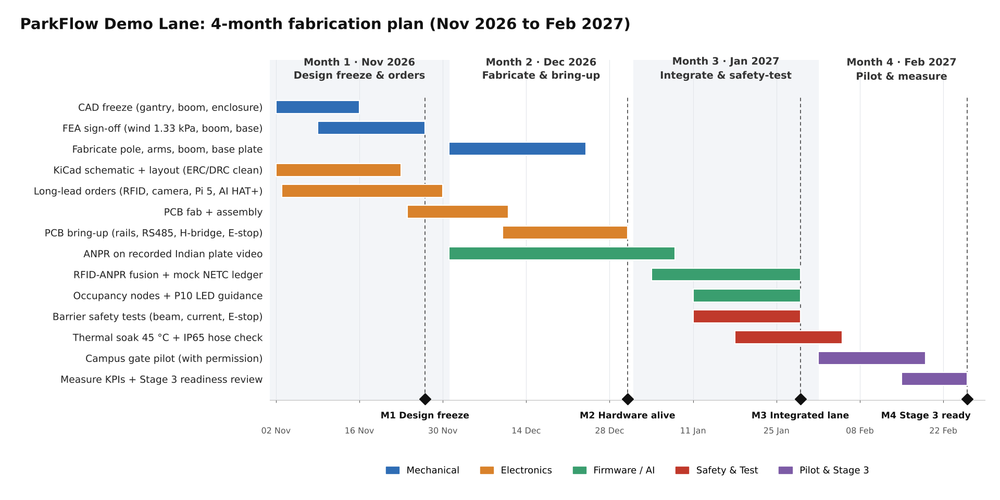

# ParkFlow Demo Lane: 4-Month Fabrication Roadmap (Nov 2026 to Feb 2027)

*Chart source: `docs/roadmap/gantt.py` (matplotlib, 1920 × 960 px). The chart shows the thermal soak running to 5 Feb, a few days past the Month 3 line in the tables below.*
All figures below are **targets, to be bench-verified**. None of them are measured results yet.

## Month 1: November 2026. Design freeze and long-lead orders → **M1 Design freeze (27 Nov)**

| Workstream | Deliverable | Exit evidence |
|---|---|---|
| Mechanical | FreeCAD CAD freeze: 2.4 m gantry pole in **80×80** 8-slot T-slot (40×40 only for the arms; the 40×40 pole in Stage 1 is predicted to fail, `cad/calcs/CALCS.md` §1), 250×250×**16** mm MS base plate + 4×M12, gussets and socket cheeks, RFID tilt bracket at 1.5 m, camera arm at 1.2 m (15 to 25° down), 1.2 m Al boom + counterweight + shear-pin hub, IP65 enclosure layout | Released drawings, unsuppressed feature tree screenshot (see Maker Journey checklist) |
| Mechanical | FEA sign-off: wind pz ≈ 1.33 kPa (IS 875-3, Vb 47 m/s) on pole, sign and boom; boom self-weight + motor stall torque on the hub; anchor pull-out | Mesh stats, convergence plot, peak von Mises and FoS stated per node. Target FoS ≥ 2.0 against yield for every structural part (the same target as `cad/calcs/CALCS.md`; the hand-calc predictions are 2.15 pole, 2.89 base plate, 6.8 boom). Shear pin sized to fail before the gearbox output rating |
| Electronics | KiCad schematic + 2-layer layout of the Lane Controller (ESP32-S3, RS485, H-bridge + shunt comparator, E-stop in series with motor supply, limit switches, photo-beam, presence, HUB12, watchdog) | ERC 0 errors, DRC 0 errors logs; Gerbers |
| Procurement | Long-lead orders: UHF reader (865 to 867 MHz), 2 MP IR PoE camera, Pi 5 8 GB + AI HAT+, DC-UPS, SMPS, IP65 enclosure, geared 24 V motor | POs with dates, from Delhi NCR / Bengaluru / Chennai / Mumbai sellers |
| Electronics | PCB order sent (fab + assembly), last week of November | Fab order confirmation |
| Data | Record or collect Indian plate video (day, night, two-wheeler) for ANPR development, with consent and blurring rules | Dataset manifest (no faces kept) |

## Month 2: December 2026. Fabrication, PCB bring-up, ANPR on recorded video → **M2 Hardware alive (31 Dec)**

| Workstream | Deliverable | Exit evidence |
|---|---|---|
| Mechanical | Cut, drill and assemble the gantry, arms, boom and base plate; dry-fit the enclosure (DIN rail, MCB/RCCB/SPD, SMPS, PoE switch, UPS, PCB) | Build photos with dimensions checked against CAD |
| Electronics | PCB bring-up: rails 24/12/5/3.3 V within ±5 %, RS485 link to the reader, H-bridge drives the motor, **E-stop cuts motor power with the MCU running**, comparator trips on a forced stall | Bring-up log, scope captures |
| Firmware/AI | ANPR pipeline (detect → OCR → Indian-format check) on Pi 5 + Hailo-8 running on **recorded** Indian plate video | Per-frame latency histogram, plate-level accuracy on a held-out set |
| RFID | Read a real FASTag EPC + TID on the bench, with the India-band channel plan set | Reader log screenshot |

## Month 3: January 2027. Integration, fusion, barrier safety tests, occupancy/LED → **M3 Integrated lane (29 Jan)**

| Workstream | Deliverable | Exit evidence |
|---|---|---|
| Firmware | RFID–plate fusion engine (time-window ±500 ms, RSSI gate, TID check), local access list, offline queue, **mock NETC ledger** | End-to-end event log: approach → decision → barrier → ledger entry |
| Safety | Barrier safety test matrix: photo-beam reverse, current-limit reverse (test object on the boom path), presence inhibit, E-stop, mains-pull → fail in place and hand-release pin works, heartbeat loss → open-and-hold, shear-pin breakaway (spare pins) | Video + pass/fail sheet per test, 20 repeats each |
| Thermal/IP | 45 °C soak of the closed enclosure (heated chamber or sun test), with SoC and air temperatures logged; IP65 hose check (informal) | Temperature-vs-time plot, throttle flag log |
| IoT | 4 occupancy nodes (ESP32-C3 + ToF/ultrasonic + WS2812) and P10 sign showing free-slot direction | Bay state vs ground-truth log |
| RFID | Adjacent-lane test (second tagged car at 3 m lateral offset) | Cross-read count before and after mitigation |

## Month 4: February 2027. Campus gate pilot and Stage 3 readiness → **M4 Stage 3 ready (26 Feb)**

| Workstream | Deliverable | Exit evidence |
|---|---|---|
| Pilot | Install at a campus gate **only with written permission** from the estate office, plus DPDP-style notice signage. Barrier in "shadow mode" first (decisions logged, the guard operates the gate), then live on a side lane for volunteer vehicles | Permission letter, install photos, earthing/RCCB test record |
| Measurement | Measure the acceptance criteria below over at least 5 days, with a manual tally as ground truth | Raw CSV + analysis notebook |
| Stage 3 | Design review, fix list, demo script, transport crate for the lane, spares (shear pins, fuses) | Readiness checklist signed by faculty mentor |

## Stage 3 commitment

> By 26 February 2027 we will have a full-height ParkFlow Demo Lane (gantry, Edge Node, Lane Controller, RFID, ANPR, safety-instrumented barrier, occupancy and LED guidance). We will demonstrate it live at Stage 3, reading a real FASTag and a real plate, fusing them on the Edge Node, opening the barrier and posting to a mock NETC ledger, and we will present measured pilot data against the four acceptance criteria below.

## Acceptance criteria (measured in Month 4; currently targets)

| # | Criterion | Target | How it is measured |
|---|---|---|---|
| AC1 | **Decision latency**: from the first RFID read or the plate frame to the barrier-open command | **p95 ≤ 300 ms** (Stage 1 claim) | Timestamps logged on the Edge Node; at least 200 passes |
| AC2 | **Fused identification accuracy** for enrolled vehicles (tag + plate both correct) | **≥ 95 % auto-pass, 0 false accepts** of non-enrolled or mismatched vehicles; the rest go to the guard/QR fallback | Pilot log compared with a manual ground-truth tally; at least 200 passes, day and night |
| AC3 | **Barrier safety**: obstruction → stop and reverse (photo-beam, current-limit, presence inhibit); E-stop → motor power cut and boom stops (no reversal); mains loss → boom stays where it is and can be released by hand (automatic opening was withdrawn; it needs the optional 24 V buffer, OPEN_DECISIONS D2) | **20/20 passes** for each of photo-beam reverse, current-limit reverse, presence inhibit and E-stop stop; mains loss → boom holds position and the hand-release pin frees it in **≤ 30 s** by one person (target, to be bench-verified; automatic opening within ≤ 5 s applies only if the optional 24 V buffer is fitted) | Month 3 test matrix, repeated at the pilot site. 20/20 only shows reliability ≥ 86 % at 95 % confidence: report it that way |
| AC4 | **Thermal robustness**: Edge Node in a sealed IP65 enclosure | **No CPU throttling** (`vcgencmd get_throttled` = 0x0) during 4 h at **45 °C** ambient with ANPR at full frame rate | Chamber or sun soak log, temperature logged every 10 s |

> **Note on confidence.** AC2 over at least 200 passes with 0 false accepts supports only a false-accept rate below about 1.5 % (95 % confidence); AC1 is a p95 over the same passes. Report the confidence bounds with the results. The Stage 1 figures (under 5 s per vehicle, 800 to 1,000 vehicles per hour, near-zero leakage) are projections and are not acceptance criteria here.
